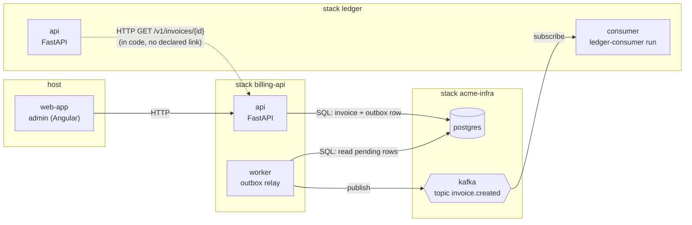
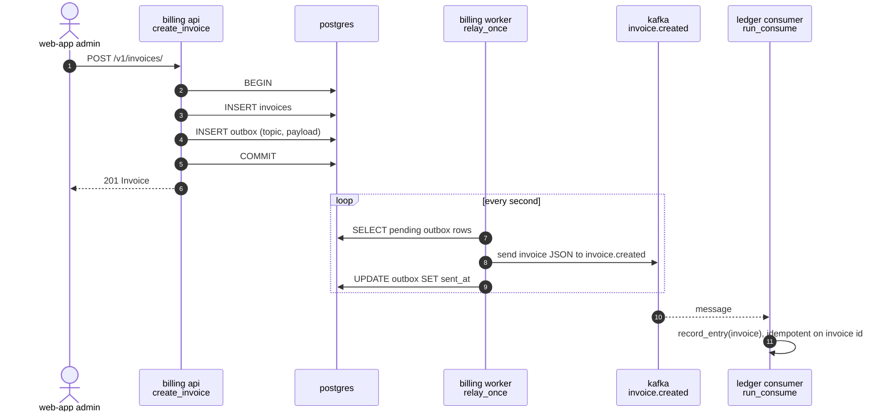
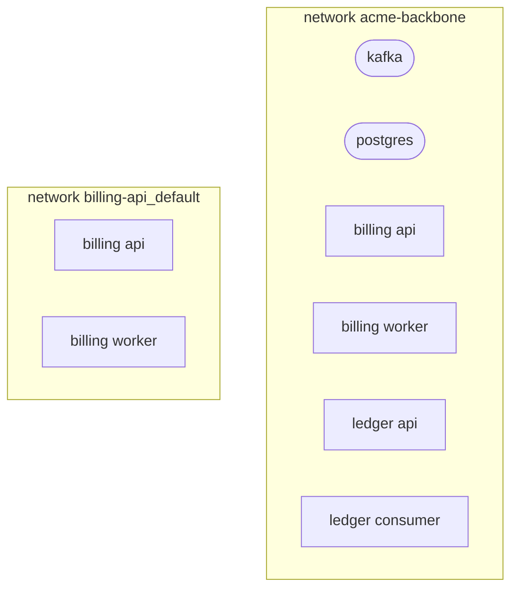
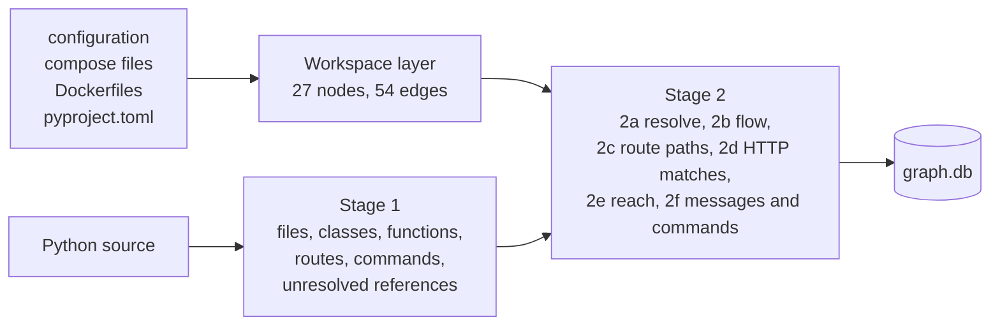
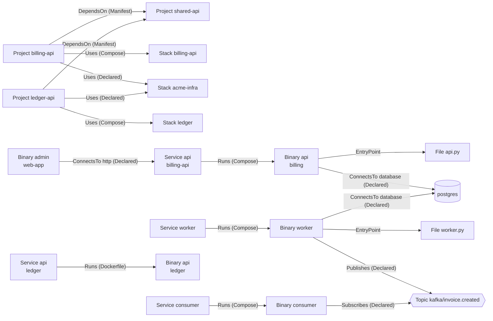
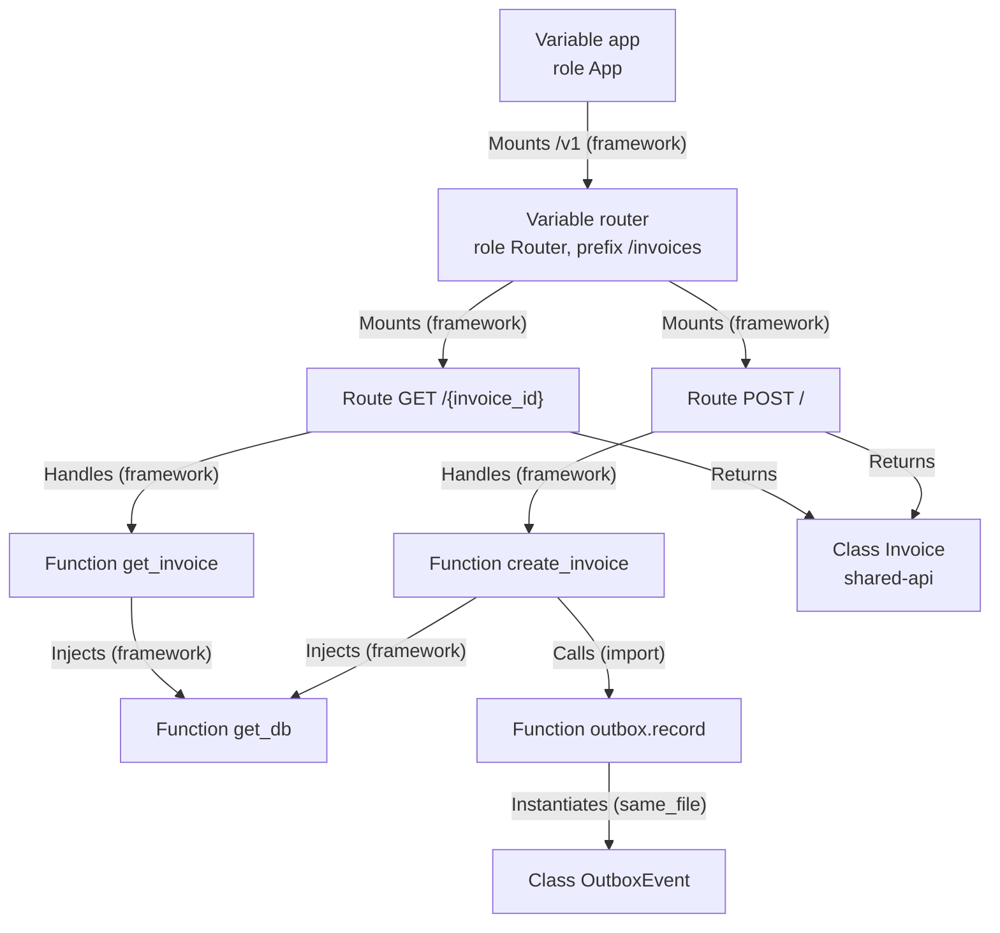
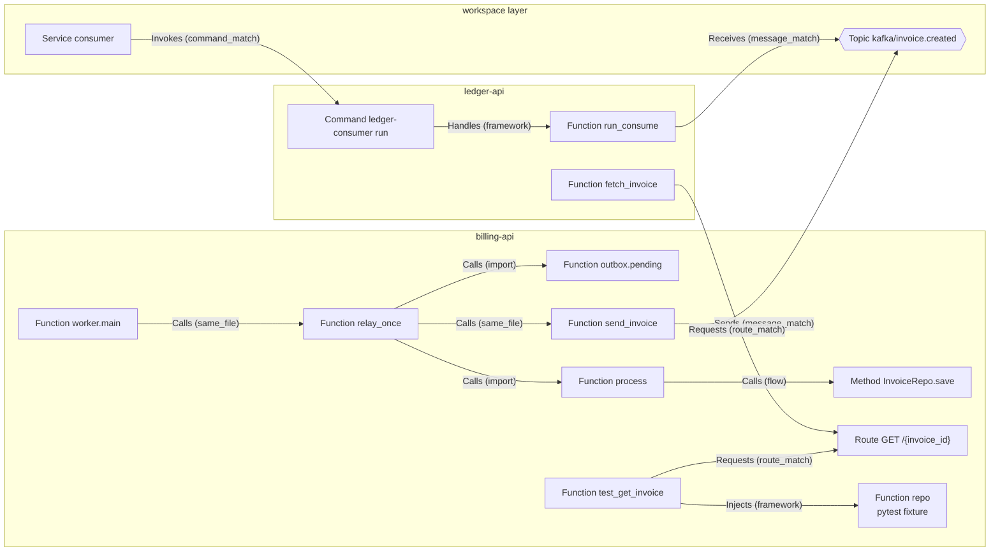
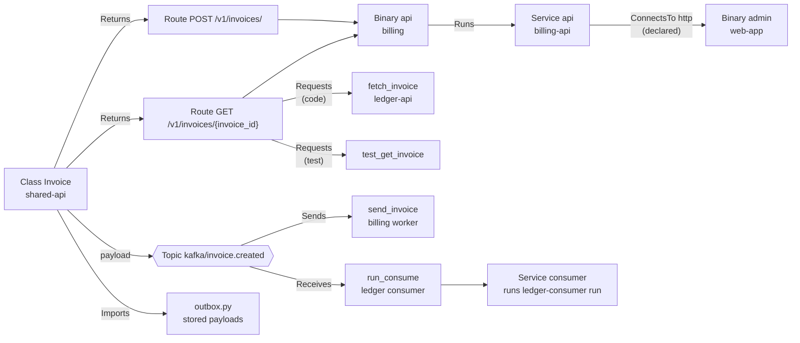

# Example Workspace: Acme Shop

A worked example of one workspace made of several separately cloned repositories. It shows what the indexer can read on its own, what the configuration has to add, how networks and links fit together, and what the finished graph holds once the code is read.

This describes the designed behaviour. The indexer is not built yet. In the first release only the Python projects have their source code read; `web-app` still appears as a project with its binary, the binary's entry file and its link. Terms are defined in [GLOSSARY.md](./GLOSSARY.md). Every configuration field is explained in the [configuration guide](./configuration-guide.md) and shown in [`templates/config.yml`](../templates/config.yml). The types the graph is made of are in [domain-model.md](./domain-model.md), and how the code is read is in [python-parsing.md](./python-parsing.md).

Acme Shop is also the test fixture: `fixtures::acme_workspace_layer()` and `fixtures::acme()` build exactly the graph described here (see [Validating an implementation](./domain-model.md#validating-an-implementation)).

## The application

Billing issues invoices through a FastAPI service. Each new invoice must reach the ledger, which records an entry for it. The two services never call each other for this: billing publishes an `invoice.created` event to Kafka, and the ledger consumes it.

Billing publishes through a **transactional outbox**. The API never talks to Kafka. It writes the invoice and an outbox row in one database transaction, and a separate worker binary relays outbox rows to Kafka. An invoice is therefore never saved without its event, and an event never names an invoice that was rolled back.

Four repositories are cloned side by side, plus one folder that holds the workspace.

```
~/acme/
├── workspace/                  # workspace root: holds .workbench/
│   ├── .workbench/config.yml
│   └── docker-compose.yml      # shared infrastructure: kafka, postgres
├── shared-api/                 # Python lib: the Invoice model, used by both APIs
├── billing-api/                # Python, uv. Binaries: api (FastAPI), worker (outbox relay)
│   ├── Dockerfile              # one Dockerfile, two build targets
│   └── docker-compose.yml
├── ledger-api/                 # Python, poetry. Binaries: api (FastAPI), consumer (argparse CLI)
│   ├── Dockerfile
│   └── docker-compose.yml
└── web-app/                    # Angular. Runs on the host with `ng serve`
```

The workspace root is the folder that holds `.workbench/`. The projects sit outside it, which the configuration allows.

## How it runs



The dotted arrow is a call that only the code shows. Ledger's `api` fetches an invoice from billing when it needs more than the event carries. Nobody declared it, so the index warns about it (see [Warnings](#warnings)).

### The outbox, step by step



The relay may send a row twice if it stops between steps 8 and 9. The consumer therefore records each invoice id once. This is the usual price of an outbox: delivery is at least once.

## The code

Only what the graph reads is shown. Imports are left out where they are obvious.

### `shared-api`

```python
# shared-api/src/shared_api/models.py
class Invoice(BaseModel):
    id: int
    customer_id: int
    total_cents: int
    currency: str
```

### `billing-api`: the FastAPI binary

```python
# billing-api/src/billing/api.py                       (entry of binary `api`)
from billing.routes import invoices

app = FastAPI()
app.include_router(invoices.router, prefix="/v1")
```

```python
# billing-api/src/billing/routes/invoices.py
router = APIRouter(prefix="/invoices")

@router.get("/{invoice_id}", response_model=Invoice)
async def get_invoice(invoice_id: int, db: Session = Depends(get_db)) -> Invoice:
    return Invoice.model_validate(db.get(InvoiceRow, invoice_id))

@router.post("/", response_model=Invoice, status_code=201)
async def create_invoice(body: InvoiceIn, db: Session = Depends(get_db)) -> Invoice:
    with db.begin():                                     # one transaction
        row = InvoiceRow(**body.model_dump())
        db.add(row)
        db.flush()
        invoice = Invoice.model_validate(row)
        outbox.record(db, INVOICE_CREATED, invoice)      # same transaction
    return invoice
```

```python
# billing-api/src/billing/db.py
engine = create_engine(settings.database_url)
SessionLocal = sessionmaker(engine)

def get_db():
    with SessionLocal() as db:
        yield db
```

```python
# billing-api/src/billing/outbox.py
INVOICE_CREATED = "invoice.created"

class OutboxEvent(Base):                                 # table `outbox`
    __tablename__ = "outbox"
    id = Column(Integer, primary_key=True)
    topic = Column(String)
    payload = Column(Text)
    sent_at = Column(DateTime, nullable=True)

def record(db: Session, topic: str, invoice: Invoice) -> None:
    db.add(OutboxEvent(topic=topic, payload=invoice.model_dump_json()))

def pending(db: Session, limit: int = 100) -> list[OutboxEvent]:
    return db.query(OutboxEvent).filter(OutboxEvent.sent_at.is_(None)).limit(limit).all()

def mark_sent(db: Session, event: OutboxEvent) -> None:
    event.sent_at = datetime.now(UTC)
```

### `billing-api`: the worker binary, the outbox relay

```python
# billing-api/src/billing/worker.py                    (entry of binary `worker`)
producer = KafkaProducer(bootstrap_servers="kafka:9092")
repo = InvoiceRepo()

def send_invoice(invoice: Invoice) -> None:
    producer.send("invoice.created", invoice.model_dump_json())

def relay_once() -> None:
    with SessionLocal() as db, db.begin():
        for event in outbox.pending(db):
            send_invoice(Invoice.model_validate_json(event.payload))
            outbox.mark_sent(db, event)
    process(repo)                                        # marks the sent invoices as published

def main() -> None:
    while True:
        relay_once()
        time.sleep(1)

if __name__ == "__main__":
    main()
```

```python
# billing-api/src/billing/services.py
def process(r):
    r.save()

# billing-api/src/billing/repo.py
class InvoiceRepo:
    def save(self): ...
```

The relay checks each payload against `Invoice` before it sends it. A malformed row stops the relay instead of reaching the ledger. It also lets the graph see what the topic carries, because the value sent is built from an `Invoice` (see [What the outbox hides](#what-the-outbox-hides)).

### `billing-api`: tests

```python
# billing-api/tests/conftest.py
@pytest.fixture
def repo():
    return InvoiceRepo()

# billing-api/tests/test_api.py
def test_get_invoice(repo):
    assert TestClient(app).get("/v1/invoices/1").status_code == 200

# billing-api/tests/test_services.py
def test_process():
    process(InvoiceRepo())
```

### `ledger-api`

```python
# ledger-api/src/ledger/api.py                         (entry of binary `api`)
app = FastAPI()

@app.post("/entries")
def add_entry(entry: EntryIn):
    invoice = fetch_invoice(entry.invoice_id)            # more than the event carries
    ...
```

```python
# ledger-api/src/ledger/clients.py
def fetch_invoice(invoice_id: int) -> Invoice:
    return Invoice.model_validate(httpx.get(f"{BILLING_URL}/v1/invoices/{invoice_id}").json())
```

```python
# ledger-api/src/ledger/consumer.py                    (entry of binary `consumer`)
def run_consume(args):
    for message in KafkaConsumer("invoice.created", bootstrap_servers="kafka:9092"):
        record_entry(Invoice.model_validate_json(message.value))

def run_replay(args): ...

def record_entry(invoice: Invoice) -> None: ...        # skips an invoice id it has seen

def main() -> None:
    parser = argparse.ArgumentParser(prog="ledger-consumer")
    sub = parser.add_subparsers(dest="cmd")
    sub.add_parser("run").set_defaults(func=run_consume)
    sub.add_parser("replay").add_argument("--from")    # handled by run_replay
    args = parser.parse_args()
    args.func(args)

if __name__ == "__main__":
    main()
```

## The three compose files

### Shared infrastructure: `workspace/docker-compose.yml`

It states its own Compose name and the network's real name.

```yaml
name: acme-infra
services:
  kafka:    {image: apache/kafka:3.8, networks: [backbone]}
  postgres: {image: postgres:16,      networks: [backbone]}
networks:
  backbone: {name: acme-backbone}
```

### Billing: `billing-api/docker-compose.yml`

It joins the same network as an external one, and builds two services from one Dockerfile with different build targets.

```yaml
services:
  api:    {build: {context: ., target: api},    networks: [default, backbone]}
  worker: {build: {context: ., target: worker}, networks: [default, backbone]}
networks:
  backbone: {external: true, name: acme-backbone}
```

### Ledger: `ledger-api/docker-compose.yml`

The network name comes from an environment variable, and the team starts this file with `docker compose -p ledger`.

```yaml
services:
  api:      {build: ., networks: [backbone]}
  consumer: {build: ., command: python -m ledger.consumer run, networks: [backbone]}
networks:
  backbone: {external: true, name: "${BACKBONE_NET}"}
```

### The two Dockerfiles

Billing builds one image per target. Ledger builds one image, and its `consumer` service overrides the command.

```dockerfile
# billing-api/Dockerfile
FROM python:3.12-slim AS base
WORKDIR /app
COPY . .
RUN pip install .

FROM base AS api
CMD ["uvicorn", "billing.api:app", "--host", "0.0.0.0"]

FROM base AS worker
CMD ["python", "-m", "billing.worker"]
```

```dockerfile
# ledger-api/Dockerfile
FROM python:3.12-slim
WORKDIR /app
COPY . .
RUN pip install .
CMD ["uvicorn", "ledger.api:app", "--host", "0.0.0.0"]
```

## What the indexer can and cannot read

| File | Readable from the file | Missing from the file |
|---|---|---|
| Infrastructure | Stack `acme-infra`. Network `acme-backbone`. `kafka` and `postgres` have no build context, so they are external services. | Nothing. |
| Billing | Network `acme-backbone`. Each build target has the name of a binary, so each service maps to its binary. The stack is named after the folder, `billing-api`. | Nothing. |
| Ledger | Two services built from the project. Which binary each service runs: `api` runs `uvicorn ledger.api:app` from the Dockerfile's `CMD`, and `consumer` runs `python -m ledger.consumer run` from its compose `command`. | The Compose name, set by `-p`. The network's real name, set by a variable. |
| Dockerfiles | The command line each service runs, and so each binary's framework: billing's and ledger's `api` are FastAPI apps, started by uvicorn. | Nothing. |
| Source code | Routes, providers, HTTP calls, Kafka sends and receives, argparse commands. | Which services talk to the database. Nothing in Release 1 matches a database client to a service. |

The configuration fills exactly the gaps in the right-hand column.

## The configuration

```yaml
# ~/acme/workspace/.workbench/config.yml
version: 1
compose:
  - files: [docker-compose.yml]       # the shared infrastructure stack
    projects: [billing-api, ledger-api]
projects:
  - id: shared-api
    path: ../shared-api
    language: python
    dependency_manager: uv
  - id: billing-api
    path: ../billing-api
    language: python
    dependency_manager: uv
    binaries:
      - {name: api,    entry: src/billing/api.py}
      - {name: worker, entry: src/billing/worker.py}
    links:
      - {service: postgres, via: database, binary: api}       # writes invoices and outbox rows
      - {service: postgres, via: database, binary: worker}    # reads and marks outbox rows
      - {service: kafka, via: topic, name: invoice.created, role: publish, binary: worker}
  - id: ledger-api
    path: ../ledger-api
    language: python
    dependency_manager: poetry
    binaries:
      - {name: api,      entry: src/ledger/api.py}
      - {name: consumer, entry: src/ledger/consumer.py}
    compose:
      name: ledger                     # set by `-p ledger`, not in the file
      networks:
        backbone: acme-backbone        # the file only says ${BACKBONE_NET}
    links:
      - {service: kafka, via: topic, name: invoice.created, role: subscribe, binary: consumer}
  - id: web-app
    path: ../web-app
    language: typescript
    dependency_manager: pnpm
    binaries:
      - {name: admin, entry: projects/admin/src/main.ts, framework: angular}
    links:
      - {service: api, stack: billing-api, via: http, binary: admin}
```

Points to notice:

- **Billing has no `compose` block.** Its compose file is found by default and everything in it is readable.
- **Both billing binaries link to `postgres`.** The outbox is a table, and the graph does not model tables. The two `database` links are what tie the API that writes rows to the worker that reads them.
- **Only the worker publishes.** The API declares no topic link, because it never talks to Kafka. That is the point of the outbox, and the graph shows it.
- **Ledger's `compose` block lists no `files`.** Its compose file is found by default too; the block only adds what the file cannot say.
- **`stack: billing-api` on the web-app link is required,** because a service named `api` exists in two stacks.
- **That stack name comes from a folder name.** It holds only while the repository is cloned as `billing-api`. Because web-app's link names the stack, `index` warns about it (`StackNamedAfterFolder`). A `name` in billing's compose file removes the warning.
- **Local dependencies are not written.** The indexer reads them from each project's `pyproject.toml`. Both APIs depend on `shared-api`.
- **`kafka` and `postgres` take no entry anywhere.** They are read from the infrastructure file as external services.
- **No binary has a `framework`, except web-app's.** Billing's and ledger's `api` are found to be FastAPI from their Dockerfiles. The worker and the consumer are plain binaries.

## How networks work

A network is only a name. For each real name, the indexer collects the services that join it.



| Network | Services | Stack |
|---|---|---|
| `acme-backbone` | `kafka`, `postgres` | `acme-infra` |
| `acme-backbone` | `api`, `worker` | `billing-api` |
| `acme-backbone` | `api`, `consumer` | `ledger` |
| `billing-api_default` | `api`, `worker` | `billing-api` |

- **A network with no stated name** is called `<Compose name>_<network>`. That is where `billing-api_default` comes from, and why the Compose name matters.
- **Without the `networks` override,** ledger's network is unknown. The indexer warns, and ledger appears cut off from `kafka`.
- **With the override,** `acme-backbone` joins three stacks, so the graph knows ledger's consumer can reach `kafka`. The override always wins over the name in the file, and the indexer only logs that it was used.
- **Links are checked against networks.** The worker reaches `postgres` and `kafka`, and all three are on `acme-backbone`, so its links are possible. A link between two services that share no network gets a warning.
- **`web-app` runs on the host,** so it has no network and its link is not checked.

Networks say who can talk. Links say who does talk, and how.

## The resolved graph

An index builds the graph in three passes. Each adds a layer, and the later ones work only on what the earlier ones stored.



### The workspace layer: what exists

Every node but the root has exactly one parent, through `Contains`. This tree is the whole of the workspace layer's 27 nodes.

```mermaid
flowchart TD
    W(["Workspace"])

    W --> P1["Project shared-api"]
    W --> P2["Project billing-api"]
    W --> P3["Project ledger-api"]
    W --> P4["Project web-app"]
    W --> S1["Stack acme-infra"]
    W --> S2["Stack billing-api"]
    W --> S3["Stack ledger"]
    W --> N1["Network acme-backbone"]
    W --> N2["Network billing-api_default"]

    P2 --> B1["Binary api"]
    P2 --> B2["Binary worker"]
    P2 --> F1["File src/billing/api.py"]
    P2 --> F2["File src/billing/worker.py"]
    P3 --> B3["Binary api"]
    P3 --> B4["Binary consumer"]
    P3 --> F3["File src/ledger/api.py"]
    P3 --> F4["File src/ledger/consumer.py"]
    P4 --> B5["Binary admin"]
    P4 --> F5["File projects/admin/src/main.ts"]

    S1 --> X1["ExternalService kafka"]
    S1 --> X2["ExternalService postgres"]
    X1 --> T1["Topic kafka/invoice.created"]
    S2 --> V1["Service api"]
    S2 --> V2["Service worker"]
    S3 --> V3["Service api"]
    S3 --> V4["Service consumer"]
```



Every arrow above is a `Contains` edge: 26 of them. The code layer hangs further nodes below the `File` nodes in the same way.

### The workspace layer: how it connects

The other 28 edges of the workspace layer are cross-links. The label on each arrow is its kind, and the text in brackets its provenance.



Left out of the drawing, to keep it readable: the three other `EntryPoint` edges, and the eight `Joins` edges of the table in [How networks work](#how-networks-work).

| Edge kind | Count | | Edge kind | Count |
|---|---|---|---|---|
| `Contains` | 26 | | `Joins` | 8 |
| `DependsOn` | 2 | | `ConnectsTo` | 3 |
| `Uses` | 4 | | `Publishes` | 1 |
| `EntryPoint` | 5 | | `Subscribes` | 1 |
| `Runs` | 4 | | `BuiltFrom` | 0 |
| | | | **Total** | **54** |

The `Runs` provenance tells the story of each service. Billing's come from build targets in the compose file. Ledger's `consumer` comes from its compose `command`, and ledger's `api` from the `CMD` of its Dockerfile.

### The code layer: billing's API and the outbox

Stage 1 reads each Python file into nodes and unresolved references. Stage 2 resolves them into edges. The text in brackets is each edge's `resolved_by`.



Stage 2c composes each route's prefixes into its full path, and stores it as a route path record.

| Route | Full path | Complete | Served by |
|---|---|---|---|
| `billing.routes.invoices.get_invoice@GET /{invoice_id}` | `GET /v1/invoices/{invoice_id}` | yes | Binary `api` of `billing-api` |
| `billing.routes.invoices.create_invoice@POST /` | `POST /v1/invoices/` | yes | Binary `api` of `billing-api` |
| `ledger.api.add_entry@POST /entries` | `POST /entries` | yes | Binary `api` of `ledger-api` |

### The code layer: the relay, the consumer and the calls across projects



Read across the middle of the drawing: `send_invoice` in billing and `run_consume` in ledger meet at one declared topic, matched from the code on both sides. The `Invokes` edge says the `consumer` service runs the `run` command, not `replay`.

### The records of stage 2

What stage 2 stores beside the edges, for this workspace.

**Inferred types (2b).** Both call sites of `process` pass an `InvoiceRepo`: the worker's `repo` and the test's `InvoiceRepo()`. So the parameter `r` takes that class, and `r.save()` becomes a `Calls` edge with `resolved_by: flow`.

| Node | Class | Evidence |
|---|---|---|
| Parameter `r` of `billing.services.process` | `InvoiceRepo` | 2 call sites |

**Reach (2e).** Which binaries may run each file. Reach follows calls, imports and framework edges, never `Sends` or `Receives`.

| File | Reached by |
|---|---|
| `src/billing/routes/invoices.py` | `api` |
| `src/billing/outbox.py` | `api` (through `create_invoice`) and `worker` (through `relay_once`) |
| `src/billing/db.py` | `api` (through `Injects`) and `worker` (through `SessionLocal`) |
| `src/billing/services.py` | `worker`, and the test `tests/test_services.py` |
| `src/ledger/clients.py` | `api` of `ledger-api` |

**Messages and payloads (2f).** Both sides carry `Invoice`. The sender builds the message with `invoice.model_dump_json()`, and the handler reads it with `Invoice.model_validate_json(...)`.

| Topic | Node | Direction | Payload |
|---|---|---|---|
| `kafka/invoice.created` | `billing.worker.send_invoice` | Send | `shared_api.models.Invoice` |
| `kafka/invoice.created` | `ledger.consumer.run_consume` | Receive | `shared_api.models.Invoice` |

**Commands (2f).** Ledger's `consumer` binary has three `Command` nodes: `ledger-consumer`, `ledger-consumer run` and `ledger-consumer replay`. The `consumer` service invokes `ledger-consumer run`.

### Warnings

| Code | Subject | Why |
|---|---|---|
| `StackNamedAfterFolder` | Stack `billing-api` | Its Compose name comes from the folder, and web-app's link names it |
| `HttpCallWithoutLink` | Function `ledger.clients.fetch_invoice` | It calls a route served by billing's `api`, and ledger declares no `http` link to it |

Adding `{service: api, stack: billing-api, via: http, binary: api}` to ledger's links removes the second warning. The graph would then hold a fourth `ConnectsTo` edge, and the fixture counts would change.

## What this gives an AI

Suppose the question is: "I am renaming a field on `Invoice` in `shared-api`. What breaks?"

Without the workspace configuration, an AI sees four unrelated repositories. With the graph, `impact` walks from the class outwards:



Arrows point from the changed class to what it affects, which is against the direction of most of the edges walked.

1. **The API contract.** `Invoice` is the response of `GET /v1/invoices/{invoice_id}` and `POST /v1/invoices/`. Both are served by billing's `api` binary, which the `api` service of stack `billing-api` runs.
2. **Its callers.** Web-app's `admin` calls that service, through a declared link. Ledger's `fetch_invoice` calls the GET route, as the code shows, and so does `test_get_invoice`. That test is the one to run.
3. **The event contract.** `Invoice` is the payload of `kafka/invoice.created`. Billing's worker sends it in `send_invoice`, and ledger's consumer reads it in `run_consume`, which the `consumer` service runs. Producer and consumer must change together.
4. **Stored events.** The outbox holds rows written with the old shape. The relay validates each one against `Invoice` before sending, so rows written before the rename fail validation until they are sent or migrated. The graph shows that `outbox.py` and `worker.py` use `Invoice`. It cannot show the rows themselves.
5. **What is not affected.** Ledger's `api` and billing's `api` share a network, but neither declares a link to the other, and no code in billing calls ledger. So nothing suggests that billing depends on ledger.

Each step names its evidence. Steps 1 and 3 come from code on both sides. Step 2 mixes code and a declared link. [python-parsing.md](./python-parsing.md#acme-shop-with-fastapi) works through how each stage produces these edges.

## What the outbox hides

The outbox puts a table between the code that decides an event happened and the code that sends it. The graph has no node for a table, so how much it can see depends on how the relay is written.

| How the relay sends | What stage 2f finds |
|---|---|
| **Typed, as here.** `send_invoice(Invoice.model_validate_json(event.payload))`, then `producer.send("invoice.created", invoice.model_dump_json())` | A `Sends` edge from `send_invoice` to `kafka/invoice.created`, with `Invoice` as payload |
| **Raw.** `producer.send(event.topic, event.payload)` | The name comes from a database row, so it is unknown (`{?}`). There is no `Sends` edge, and no payload. The call is stored as an unmatched message, and `index` raises `MessageWithoutLink`. The declared `Publishes` link still ties the worker to the topic |
| **Typed, with the topic from the row.** `producer.send(event.topic, invoice.model_dump_json())` | The payload is known on the sending side, but the name is not. Stored as an unmatched message, as above |

Even in the typed form, two facts stay outside the graph:

- **No edge joins `create_invoice` to the topic.** The API writes a row and the worker reads it, and the graph does not model the table. What ties them together is that both binaries link to `postgres` and both use `outbox.py`. `impact` on `create_invoice` names billing's `api` service and its callers. It does not name the ledger consumer.
- **The topic named when a row is written is not checked.** `outbox.record(db, INVOICE_CREATED, invoice)` stores the topic as data. Only the relay's `send` call is matched to a declared topic.

Keep the relay typed and the topic a literal or a constant at the `send` call. The graph can then see the event contract as clearly as it would without an outbox.
